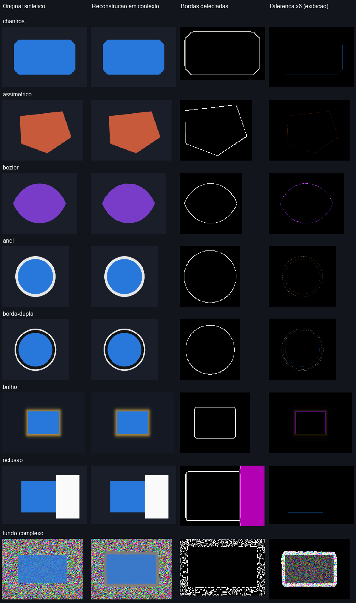

# Interface X-Ray

Skill em português para **Codex e Claude Code**: investigar, medir e recriar interfaces web e Android com evidências visuais e aprovação do usuário em cada etapa.

Parte de uma imagem, URL ou app Android acessível. Separa UI e fundo, mede geometria, estima tipografia, define limites de layout e compara a recriação com a referência. Inclui ferramentas locais para pixels, marcações, diferenças de imagens e captura ADB.

## Começar

1. Baixe a [versão publicada](https://github.com/FabioSilva11/interface-xray/releases/latest) ou clone este repositório.
2. Copie a pasta **`interface-xray` inteira** para o diretório de skills do seu ambiente:

| Ambiente local | Dentro do projeto | Em todos os projetos do usuário |
| --- | --- | --- |
| Codex | `.agents/skills/interface-xray/` | `~/.agents/skills/interface-xray/` |
| Claude Code | `.claude/skills/interface-xray/` | `~/.claude/skills/interface-xray/` |

3. Para os utilitários de imagem, instale Python 3.10+ e execute, dentro da pasta da skill: `python -m pip install -r requirements.txt`. O fluxo em Markdown pode ser usado sem esses utilitários.
4. No Codex, invoque `$interface-xray`; no Claude Code, `/interface-xray`. Anexe a referência ou informe o alvo.

> Use a skill interface-xray para recriar esta interface. Mostre imagens do progresso, pergunte se cada etapa está alinhada e onde há erros, aguarde minha confirmação e repita as etapas que eu pedir para corrigir.

Consulte o [manual completo](interface-xray/MANUAL.md) para instalação em Windows/macOS/Linux, comandos, exemplos, dependências e limitações.

## Capacidades

| Recurso | O que entrega |
| --- | --- |
| Decomposição visual | Regiões, componentes, formas, textos, assets, efeitos e camadas. |
| Medição | Caixas e coordenadas em pixels da imagem; unidades lógicas quando calibradas. |
| Tipografia | Texto conferido, candidatos de fonte, peso, tamanho, quebras e baseline. |
| Layout | Ancoragens, mínimos/máximos, gaps, proporções, overflow e regras responsivas. |
| Android | PNG renderizado, metadados e hierarquia exposta via ADB; procedimento para limites de layout. |
| Web | Pesquisa do original, inspeção da rota e fluxo de cópia offline com CSS e assets necessários. |
| Recursos indisponíveis | Inventário de restrições e alternativas públicas/localmente representativas para revisão. |
| Progresso acompanhado | Fotos/capturas reais, pedido de opinião, confirmação, correção e histórico por etapa. |
| Validação | Sobreposição, imagem de diferenças, métricas de pixels e revisão por região. |
| Geometria matemática opcional | Caminhos editáveis, chanfros/polígonos/Béziers/arcos, SDF, faixas e efeitos estimados, com revisão por parâmetros. |

Os scripts automatizam tarefas delimitadas. Reconhecimento de componentes/fontes, busca da origem, coleta web e revisão continuam conduzidos pelo agente com as ferramentas disponíveis. Uma screenshot não comprova dp, fonte, CSS original nem conteúdo escondido por regiões opacas.

## Documentação e ferramentas

### Comparação geométrica

Exemplos sintéticos reproduzíveis. A última coluna amplia diferenças 6× apenas para exibição. A reconstrução contextual preserva o exterior do componente e oclusões; o fundo texturizado mostra uma limitação real de aparência. Consulte [condições e resultados](docs/examples/README.md).

- [Instruções da skill](interface-xray/SKILL.md).
- [Manual e catálogo completo de capacidades](interface-xray/MANUAL.md).
- [Imagens: inspeção, anotações e comparação](interface-xray/references/image-tools.md).
- [Contornos: extração matemática, SVG e revisões](interface-xray/references/contour-tools.md).
- [Coleta Android](interface-xray/references/android-acquisition.md) e [utilitário ADB](interface-xray/references/adb-tool.md).
- [Origem e cópia offline web](interface-xray/references/web-acquisition.md).
- [Modelo de relatório e revisão](interface-xray/references/report-template.md).
- [Desenvolvimento e validação](CONTRIBUTING.md).

## Compatibilidade e verificação

O núcleo usa o formato Agent Skills, com `name`, `description` e Markdown. As ferramentas de visão, navegador, pesquisa e ADB dependem da instalação. A cópia local da skill não habilita automaticamente skills na conta web do Claude.

Os testes incluem imagens sintéticas, subprocessos ADB simulados e integridade do pacote. Não substituem testes em um app, dispositivo, site ou sessão do Claude reais. A automação do repositório executa a suíte em Windows e Linux.

## Licença

Uma licença de redistribuição ainda não foi definida para este repositório. Nenhum asset de app/site usado como referência é distribuído no pacote.
