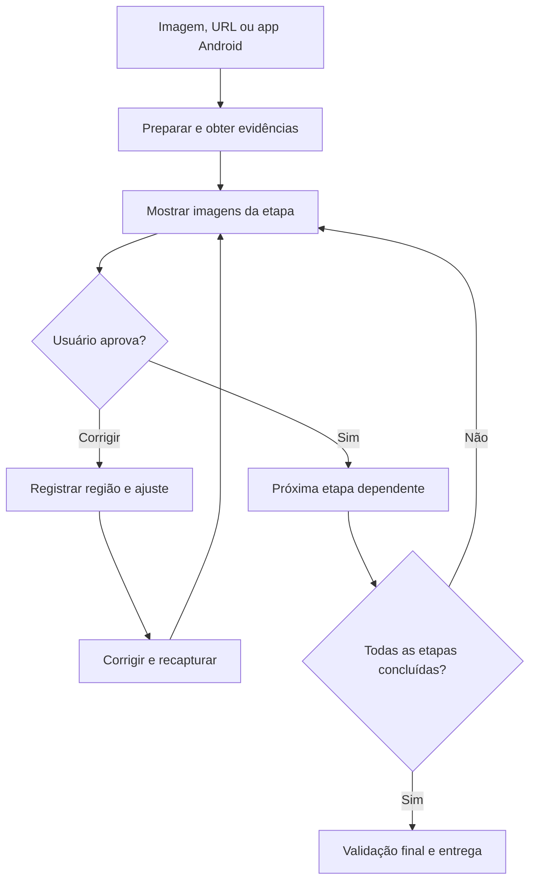

# Manual da Interface X-Ray

## 1. Finalidade

Esta skill orienta Codex ou Claude Code na recriação fiel de uma interface, com preparação, coleta, medições, implementação quando pedida e validação visual. O usuário acompanha imagens reais e aprova cada etapa dependente. O agente registra se um resultado é medido, estimado, proposto ou desconhecido.

Ela combina instruções portáteis com dois utilitários Python. Não é um conversor autônomo de screenshot em código nem recupera automaticamente o código-fonte original de um app.

## 2. Instalação

Obtenha a pasta `interface-xray` pelo ZIP da release ou pelo repositório. Ela deve conter `SKILL.md`, este manual, `references/`, `scripts/` e `requirements.txt`. Não copie somente o `SKILL.md`.

### Codex local

Para um projeto, coloque a pasta em `.agents/skills/interface-xray/`. Para uso pessoal em todos os projetos, em `~/.agents/skills/interface-xray/`. Invoque pelo nome `$interface-xray` ou solicite a skill em linguagem natural.

### Claude Code local

Para um projeto, use `.claude/skills/interface-xray/`. Para uso pessoal, `~/.claude/skills/interface-xray/`. Invoque `/interface-xray` ou solicite pelo nome.

No Windows, `~` corresponde à pasta do usuário. Se for copiar por PowerShell, execute a partir de uma cópia do repositório e escolha um dos destinos. Estes exemplos interrompem a instalação se a skill já existir:

```powershell
$skillDestination = Join-Path $env:USERPROFILE '.agents\skills\interface-xray'
if (Test-Path -LiteralPath $skillDestination) { throw 'A skill já existe nesse destino; revise a versão antes de atualizar.' }
New-Item -ItemType Directory -Force -Path (Split-Path -Parent $skillDestination) | Out-Null
Copy-Item -LiteralPath '.\interface-xray' -Destination $skillDestination -Recurse
```

Para Claude Code, troque o trecho `.agents\skills\interface-xray` por `.claude\skills\interface-xray`. Para instalação por projeto, faça a cópia para a pasta correspondente dentro do projeto, em vez da pasta pessoal.

No macOS/Linux, a partir da raiz do repositório, instale no Codex pessoal assim:

```bash
mkdir -p ~/.agents/skills
test ! -e ~/.agents/skills/interface-xray && cp -R interface-xray ~/.agents/skills/interface-xray
```

Para Claude Code, use `~/.claude/skills` nos dois lugares. Preserve a versão existente antes de qualquer atualização. Não crie duas skills com o mesmo nome no mesmo ambiente sem verificar a seleção.

No Claude em navegador, Cowork ou sessões em nuvem, use o mecanismo de skills disponibilizado pela conta. A instalação local não garante disponibilidade nesses ambientes. Consulte a [documentação do Claude Code](https://code.claude.com/docs/en/skills) e a [documentação do Codex](https://learn.chatgpt.com/docs/build-skills) para os locais e mecanismos de descoberta.

## 3. Dependências e modos

| Uso | Requisito |
| --- | --- |
| Instruções e análise guiada | Agente capaz de ler a skill e visualizar a referência. |
| Inspeção, anotações e comparação locais | Python 3.10+ e Pillow instalado por `python -m pip install -r requirements.txt`, dentro da pasta da skill. |
| Captura Android pelo script | Python 3.10+, Android SDK Platform Tools/ADB e dispositivo autorizado. |
| Pesquisa da origem web | Pesquisa/navegador disponibilizados ao agente. |
| Inspeção/cópia web | Navegador, DevTools, integração ou ferramentas locais capazes de observar e salvar os recursos necessários. |
| Exibição do progresso | Ambiente que mostre anexos, prévias ou imagens acessíveis ao usuário. |

Não há instalação automática de ADB, navegador, plugins ou frameworks. A falta de uma ferramenta deve aparecer no diagnóstico; não pode ser preenchida com um resultado inventado.

## 4. Catálogo de capacidades

| Capacidade | Execução e evidências | Limite |
| --- | --- | --- |
| Preparar a referência | Agente identifica arquivo, enquadramento, plataforma e estado. | Imagem recortada ou reamostrada pode não revelar o viewport. |
| Ler pixels | `image_tools.py inspect` informa dimensões, hash, modo e amostras reais. | Não classifica semanticamente todos os pixels. |
| Formas e componentes | Agente identifica retângulos, círculos, bordas, botões, cards e grupos. | Aparência não comprova interatividade. |
| Geometria | Agente registra caixas, gaps e alinhamentos; script desenha caixas fornecidas. | Não há detector automático de todos os componentes. |
| Unidades | Conversões após calibração de escala/densidade. | CSS px, dp, sp e iOS pt não são intercambiáveis. |
| Tipografia | OCR quando disponível, conferência visual e teste de candidatos. | Altura de tinta não determina `font-size`; identificação exata não é garantida. |
| Profundidade | Oclusão e efeitos sustentam ordem de camadas proposta. | Não revela distância 3D ou `z-index` original. |
| UI e fundo | Inventário, assets originais, recortes e máscaras quando a ferramenta permitir. | Partes ocultas por opacidade não existem na captura. |
| Layout | Regras de largura/altura, mínimos/máximos, fluxo, recorte e overflow. | Uma captura não determina breakpoints exatos. |
| Android renderizado | `adb_capture.py` coleta PNG, configuração e XML quando exposto. | XML é acessibilidade; Compose/Canvas podem ter cobertura parcial. |
| Limites Android | Procedimento de ativação, captura e restauração nas Opções do desenvolvedor. | O script não ativa a opção; o rótulo `bounds` não comprova seu estado. |
| Descobrir site original | Pesquisa por pistas públicas e comparação com candidatos. | Pode não haver correspondência confirmada ou a versão pode ter mudado. |
| Cópia offline por rota | Agente coleta dependências e organiza uma versão local dos estados escolhidos. | Não inclui backend privado nem espelhamento automático do site inteiro. |
| Substituir recursos privados | Agente informa restrição, mostra alternativas e registra aprovação. | Alternativa pública pode reduzir a fidelidade. |
| Progresso e correção | Imagens por etapa/revisão, pergunta de opinião e aprovação explícita. | Sem imagem real, a revisão correspondente fica pendente. |
| Comparação de pixels | `image_tools.py compare` produz overlay, diferenças e métricas calculadas. | Métrica de pixels não equivale a porcentagem de fidelidade. |

## 5. Fluxo de uma sessão



Etapas usuais: origem/preparação, coleta, calibração, camadas, geometria, tipografia, limites de layout, cópia/implementação e comparação final. O agente identifica a etapa atual e sua revisão, por exemplo: “geometria, revisão 2, aguardando revisão”.

Cada checkpoint apresenta a referência, o resultado e o que conferir. A pergunta é: **“Esta etapa está alinhada com a referência? Onde você vê algo errado e como deveria ficar?”** Silêncio não conta como aprovação. Uma crítica reabre a etapa afetada; mudanças que invalidem medições anteriores exigem nova revisão dessas medições.

Antes de esperar a resposta, configurações temporárias e instrumentação são restauradas/encerradas. Uma revisão humana não justifica manter o aparelho alterado.

## 6. Ferramentas de imagem

Dentro da pasta da skill, veja a ajuda:

```text
python scripts/image_tools.py --help
```

Use os comandos `inspect`, `annotate` e `compare` conforme a [referência completa](references/image-tools.md). A entrada de anotações usa caixas e IDs fornecidos pelo agente ou por uma ferramenta de medição. O script não inventa caixas ou unidades lógicas.

A comparação exige dimensões iguais. Ela não desloca nem redimensiona imagens para melhorar o resultado. Transparência é composta sobre o fundo documentado pelo utilitário. Fontes, estado, escala e conteúdo devem corresponder antes de interpretar as diferenças.

## 7. Android via ADB

Use a [coleta Android](references/android-acquisition.md) e o [manual do script ADB](references/adb-tool.md). Selecione o serial correto, confirme o alvo com o usuário e obtenha uma coleta limpa antes da instrumentada. Mostre as duas e a interpretação dos limites.

O script obtém uma coleta por execução; não altera densidade, tamanho de fonte, opções de desenvolvedor ou limites de layout. A ativação/restauração dessas opções faz parte do procedimento conduzido pelo agente/usuário. Os arquivos `capture.json`, PNG e XML disponível devem permanecer associados ao estado observado.

Uma falha da hierarquia não torna um PNG válido inútil: registre a cobertura parcial. Uma superfície protegida ou ferramenta indisponível deve ser informada, sem prometer extração completa.

## 8. Web e versão offline

Sem URL, o agente pesquisa a origem antes de assumir a reconstrução somente pela imagem. Mostra os candidatos e pede confirmação. Se não localizar a origem, registra a busca e valida o uso da referência fornecida.

Com a origem confirmada, coleta somente a rota e os estados necessários. Inclui estilos, fontes, imagens de conteúdo e fundo, máscaras/SVGs, recursos responsivos e comportamento local indispensável. Mostra a primeira cópia e, depois, uma comparação antes/depois da limpeza.

Links públicos fora da interface podem permanecer externos. Recursos visuais necessários precisam estar locais para a entrega ser declarada offline. Um site que desenha a interface usando fonte, CSS, imagem ou API remota indispensável é híbrido. Recursos privados são informados e substituídos por alternativas apropriadas, apresentadas para revisão.

Não há um downloader web universal incluído. A aquisição é executada pelo agente usando as ferramentas do ambiente, seguindo o [procedimento web](references/web-acquisition.md). Uma SPA pode exigir reconstrução local porque baixar o HTML não preserva sua renderização ou seu backend.

## 9. Entregáveis

Conforme o escopo, a sessão produz relatório, imagens originais/anotadas, inventário de componentes, mapa de camadas, hipóteses de tipografia, contrato de layout, manifesto de recursos, pasta offline e comparação final. O [modelo de relatório](references/report-template.md) reúne as evidências e decisões.

Mantenha imagens por etapa e revisão. Relacione cada correção à região/ID, comentário do usuário, alteração aplicada e nova captura. Não sobrescreva as evidências anteriores nem declare uma aprovação que não aconteceu.

## 10. Exemplos de pedidos

**Somente diagnóstico:**

> Use interface-xray nesta imagem. Quero calibração, camadas, medidas, tipografia e contrato de layout. Mostre as imagens e aguarde minha confirmação em cada etapa. Não implemente ainda.

**Android:**

> Use interface-xray para recriar a tela deste app no dispositivo informado. Colete a tela renderizada e a hierarquia via ADB, faça capturas com limites de layout, restaure as configurações e mostre o progresso para minha revisão.

**Web sem URL:**

> Use interface-xray nesta screenshot de site. Pesquise o original e mostre candidatos. Se eu confirmar a origem, produza uma cópia offline somente desta interface, com CSS e assets necessários. Informe recursos privados e mostre as alternativas públicas.

**Corrigir uma etapa:**

> A etapa de geometria está desalinhada. O E04 está muito alto e o recorte da imagem E02 está errado. Corrija essas regiões, mostre a nova comparação e peça minha confirmação novamente.

## 11. Solução de problemas

| Situação | Ação |
| --- | --- |
| Skill não aparece | Verifique pasta completa, nome, local de instalação e descoberta no ambiente. |
| Python não encontra Pillow | Instale `requirements.txt` no mesmo interpretador usado para executar o utilitário. |
| Saída já existe | Use novo nome/diretório por revisão; os scripts preservam evidências existentes. |
| Imagens têm tamanhos diferentes | Confira viewport, DPR e enquadramento; não force redimensionamento silencioso. |
| ADB unauthorized/offline | Autorize/conecte o aparelho correto antes de coletar. |
| XML ausente ou incompleto | Use o PNG e declare limitação da estrutura exposta. |
| Origem web não encontrada | Continue pela referência depois de validar essa alternativa com o usuário. |
| Offline depende de rede | Identifique o recurso, copie/substitua quando possível ou declare entrega híbrida. |
| Usuário aponta erro pouco localizado | Peça região/ID e o aspecto esperado antes de escolher a correção. |

## 12. Validação e alcance desta versão

O repositório inclui testes automatizados de imagens sintéticas, fronteira ADB simulada, integridade dos documentos e geração do pacote. Não há teste ao vivo obrigatório de dispositivo, site ou Claude para instalar a skill. A execução real deve registrar as ferramentas e evidências utilizadas.

Leia a [especificação Agent Skills](https://agentskills.io/specification) para o formato. Os procedimentos técnicos incluem fontes oficiais nos respectivos guias. Uma licença de redistribuição ainda não foi definida nesta versão.
